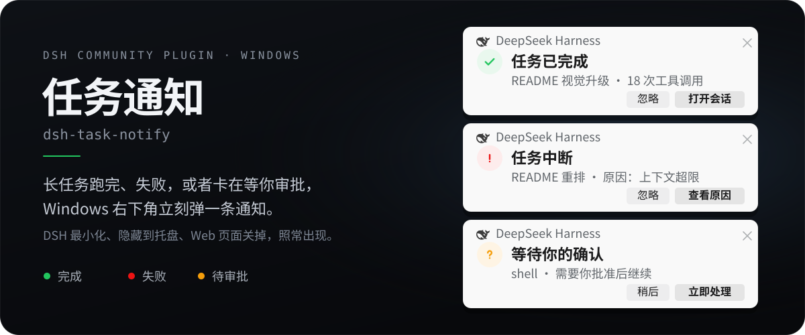
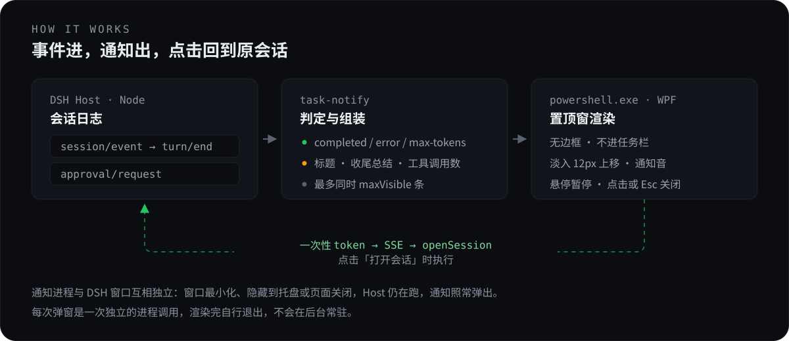
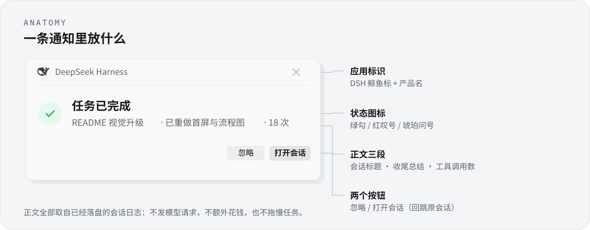

<p align="center">
  
</p>

<p align="center">
  <a href="https://github.com/AnsonLi-better/dsh-task-notify/blob/master/LICENSE"></a>
  
  
  
  
</p>

<p align="center">
一个 <a href="https://github.com/deepseek-ai/deepseek-harness">DeepSeek Harness</a> 社区插件：任务<strong>完成</strong>、<strong>失败</strong>或<strong>等待审批</strong>时，在 Windows 右下角弹出系统级通知。<br>
<sub>DSH 窗口最小化、隐藏到托盘、甚至 Web 页面被关掉，通知照常出现。</sub>
</p>

---

## 为什么需要它

跑长任务时你总会切去干别的。任务什么时候结束？是不是失败了？有没有卡在等你批准某个操作？——切回来一眼看不出来，干等又浪费时间。

这个插件把这三件事推到 Windows 通知该在的位置，像收到一封邮件那样自然，而不是让你守着窗口。

## 工作方式

<p align="center">
  
</p>

关键在于**通知不由 DSH 的窗口渲染**。Host 进程每判定一次，就拉起一个独立的 `powershell.exe` + WPF 进程画一张卡片，画完自己退出。所以渲染链路与 DSH 窗口的可见性完全无关。

| DSH 事件 | 判定 | 通知状态 |
|---|---|---|
| `session/event` → `turn/end` | `reason.kind === 'completed'` | 完成 |
| `session/event` → `turn/end` | `error` / `max-tokens` / `interrupted` | 失败 |
| `approval/request` | 任意工具审批 | 待审批 |

`forked` 与用户主动中止不弹，避免噪音；子代理默认不弹，可在面板里打开。

## 通知里放了什么

<p align="center">
  
</p>

正文 = **会话标题 · 收尾总结 · 工具调用数**，三段都来自**已经落盘的会话日志**：

- **会话标题** — 从 DSH 的 `sessionTitle` 服务读取，没有就省略
- **收尾总结** — 取会话日志里最后一条 assistant 消息的最后一个文本块，去掉 Markdown 标记后取最后一个非空行。模型自己写的收尾就是最好的总结，不必再调一次模型
- **工具调用数** — 只统计**本轮 turn** 的 `tool/call` 事件，不是整个会话

全程**不发模型请求**，零额外成本，也不拖慢任务。

## 安装

> **只需要三步**：复制一句话给助手 → 重启 DSH → 点一下「试弹一次」。不需要命令行，不需要改配置文件。

### 前置要求

| 项目 | 要求 | 怎么确认 |
|---|---|---|
| DeepSeek Harness | ≥ 0.2.0 | 应用菜单 →「关于 DeepSeek Harness」看版本 |
| 操作系统 | Windows 10 / 11 | — |
| PowerShell 5.1 | 系统自带 | 无需操作 |
| .NET Framework 4.8 | 系统自带 | 无需操作 |

不需要安装 Node.js、Python 或任何额外运行时。

### 方式一：让 DSH 里的助手装（最省事）

在 DSH 里新建一个会话，把下面整段发过去：

```text
帮我安装 DSH 插件「任务通知」，装完告诉我怎么验证。

插件地址：https://github.com/AnsonLi-better/dsh-task-notify
注意：插件包在仓库的 bundle/ 子目录，所以安装时必须带上 #path:/bundle，
完整参数是 github:AnsonLi-better/dsh-task-notify#path:/bundle

安装命令（在当前 profile 里执行）：
  & "$env:LOCALAPPDATA/Programs/DeepSeek Harness/resources/runtime/cli/bin/dsh.cmd" `
    plugin --profile $env:DSH_PROFILE add github:AnsonLi-better/dsh-task-notify#path:/bundle

如果 $env:DSH_PROFILE 为空，就用 desktop。
装完请提醒我重启 DSH。
```

助手会自己读到 `DSH_PROFILE`，装到你正在用的那个 profile 里，不需要你告诉它用哪个。

### 方式二：图形界面装（不想用命令行）

1. 打开 **设置 → 插件**
2. 点右上角 **添加插件**
3. 选 **安装第三方插件**
4. 在「包名或地址」里粘贴这一整行：

   ```
   github:AnsonLi-better/dsh-task-notify#path:/bundle
   ```

5. 点 **安装**，等它跑完
6. 提示「已安装，请重启 DSH」时，**重启 DSH**

> 界面上还能切换「安装源」。国内网络访问 GitHub 慢的话，先切到「中国大陆镜像源」再重试。

### 方式三：命令行装

```powershell
& "$env:LOCALAPPDATA/Programs/DeepSeek Harness/resources/runtime/cli/bin/dsh.cmd" `
  plugin --profile desktop add github:AnsonLi-better/dsh-task-notify#path:/bundle
```

- `--profile` 必须写，桌面版用 `desktop`。不确定就先用 `$env:DSH_PROFILE`。
- DSH 装在别处时，把 `dsh.cmd` 的路径换成你的实际路径。

### ⚠️ 最容易踩的坑：漏掉 `#path:/bundle`

插件包在仓库的 `bundle/` 子目录，**不在根目录**。漏掉这个后缀，安装会「成功」但装到的是一个空包：

```text
+ dsh-task-notify 0.0.0        ← 版本 0.0.0 就是装错了
```

正确的结果是 `0.1.0`：

```text
+ dsh-task-notify 0.1.0        ← 这才是对的
```

看到 `0.0.0` 就卸载重装，记得补上 `#path:/bundle`。

### 装完必须重启

插件分 Host 和 Client 两半：Host 半边重启后生效，设置面板要等页面重新加载才出现。**重启 DSH 是最省事的做法**，否则可能只有通知能用、面板看不见。

### 验证：确认真的能用

**第一步，确认装上了。** 设置 → 插件，列表里应该出现「任务通知」，状态是运行中。

**第二步，点一下试弹。** 打开 **设置 → 插件 → 任务通知**，点「试弹一次 · 完成」，右下角应弹出绿色通知。

**第三步，最小化再试一次。** 把 DSH 主窗口最小化，再点「试弹一次 · 失败」，红色通知仍应出现——这是这个插件的核心价值。

三步都过，就装好了。之后正常跑任务，结束时会自动弹通知。

命令行验证（可选）：

```powershell
& "$env:LOCALAPPDATA/Programs/DeepSeek Harness/resources/runtime/cli/bin/dsh.cmd" `
  plugin --profile desktop list
```

依赖列表里应出现 `dsh-task-notify@0.1.0`。

### 装不上怎么办

| 现象 | 原因 | 解决 |
|---|---|---|
| 装成了 `0.0.0` | 漏了 `#path:/bundle` | 卸载后补上后缀重装 |
| 图形界面报「没有声明组合包」「未找到相关插件」或「不是有效的插件包」 | 同上，指向了仓库根目录 | 卸载后补上 `#path:/bundle` 重装 |
| 提示「无法连接插件源」 | 访问不了 GitHub | 换「中国大陆镜像源」，或用方式三并配置代理 |
| 装完面板里找不到 | 没重启 DSH | 完全退出 DSH 再打开 |
| 有面板，但不弹通知 | 全部静音被打开，或不是 Windows | 检查面板顶部的「全部静音」开关 |
| 弹窗一闪就没了 | 停留时长被调太短 | 面板里把「停留时长」调到 5 秒以上 |

还是不行，把 **设置 → 插件 → 任务通知** 面板底部的事件流水截图发到 [Issues](https://github.com/AnsonLi-better/dsh-task-notify/issues)，那里会记录每次弹窗失败的原因。

### 卸载

图形界面：设置 → 插件 → 找到「任务通知」→ 卸载。

命令行：

```powershell
& "$env:LOCALAPPDATA/Programs/DeepSeek Harness/resources/runtime/cli/bin/dsh.cmd" `
  plugin --profile desktop remove dsh-task-notify
```

卸载后同样需要重启 DSH。

### 开发用：装本地目录

```powershell
git clone https://github.com/AnsonLi-better/dsh-task-notify.git
& "$env:LOCALAPPDATA/Programs/DeepSeek Harness/resources/runtime/cli/bin/dsh.cmd" `
  plugin --profile desktop add "C:/path/to/dsh-task-notify/bundle"
```

注意路径要指向 `bundle/`，不是仓库根目录。

## 配置

面板改动即改即生效，也支持在 profile 的 `cordis.patch.yml` 里预设：

```yaml
- id: task-notify
  name: 'dsh-task-notify'
  config:
    durationMs: 6000        # 停留时长，1500–60000 毫秒
    maxVisible: 3           # 同时最多保留几条窗口，1–5
    notifySubagents: false  # 子代理任务也弹
    sound: true             # 播放提示音
    soundVolume: 35         # 音量 0–100
    mute: false             # 全局静音
    theme: system           # system / light / dark
```

## 设置面板

**设置 → 插件 → 任务通知**：

| 控件 | 说明 |
|---|---|
| 全部静音 | 一键停掉所有弹窗，不改动其他设置 |
| 停留时长 | 2–30 秒滑杆；鼠标悬停会暂停倒计时 |
| 提示音量 | 0–100，跟随系统音量 |
| 播放提示音 | 完成/失败用系统通知音，待审批用更轻的提示音 |
| 子任务也提醒 | 默认关闭，避免并行子任务刷屏 |
| 外观 | 跟随系统 / 浅色 / 深色 |
| 试弹一次 | 完成 / 失败 / 待审批，不用真跑任务 |

下方是运行状态（已弹出条数、正在显示条数、当前主题、平台）与最近 20 条事件流水（时间、状态、标题、耗时）。

## 「打开会话」是怎么做到的

桌面版的 `dsh://open` 只负责唤起窗口，不负责选会话。插件用一条本机 SSE 通道补齐这一步：

1. 每条通知生成一个**一次性 token**，随通知窗口一起交给 PowerShell 进程。
2. 点击主按钮时，通知进程先同步调用 Windows 窗口 API 把已有的 DSH 窗口恢复并请求前台焦点。
3. 同时带着 token 请求 Host 的本机接口；Host 校验后通过 SSE 把目标 `sessionId` 推给页面。
4. 页面里的 Client 半边调用 `uiWorkspace.openSession(sessionId)`，成功后回执消费该请求。
5. 只有找不到可激活窗口时，才回退到 `dsh://open` 启动（启动前会清掉继承来的 `ELECTRON_RUN_AS_NODE`）。

这条连接不依赖设置面板是否打开，也不因页面隐藏而暂停；页面重连时 Host 会补发尚未确认的请求。Host 重启后不保留待跳转请求。

接口只监听回环地址，并校验 `Host` 与 `Origin`，非本机来源直接 403。

## 已知限制

- **不进 Windows 通知中心。** 系统 toast 只能由注册过 AppUserModelID 的应用进程发出，插件冒充不了 DSH 主程序，所以走自绘置顶窗口——历史通知无法在通知中心翻看。
- **仅 Windows。** macOS / Linux 需要各自的通知机制，未实现。
- **每次弹窗有 1.3–2.2 秒的冷启动。** 独立 PowerShell 进程要加载 WPF 再渲染，本机实测首次约 2.2 秒、之后 1.3–1.5 秒才可见。对「任务结束」这种秒级事件可以接受，但它不是即时反馈。
- **同时出现的通知位置相同。** 窗口数量受 `maxVisible` 限制、超出时回收最早的一条，但几张卡片都贴在右下角同一位置，最新的会盖住较早的。想同时看多条就把 `maxVisible` 调小。
- **审批通知不能直接批准。** 点通知只关闭弹窗，审批仍需回到 DSH 界面操作——这是故意的安全边界。
- **「打开会话」需要页面处于加载状态。** 跳转链路是 Host 经 SSE 推给页面里的 Client 半边，所以 DSH 窗口必须已经打开（可以最小化）。

## 目录结构

```
dsh-task-notify/
├── bundle/                    # DSH 插件本体（安装这个目录）
│   ├── package.json           # dsh.bundle + dsh.client 声明
│   ├── cordis.patch.yml       # Loader 行 + 默认配置
│   ├── index.js               # Host 半边：事件监听、进程管理、面板 API
│   ├── client.js              # Client 半边：设置面板 + SSE 跳转
│   ├── assets/toast.ps1       # WPF 渲染脚本（UTF-8 with BOM，勿改编码）
│   ├── locale/{zh,en}.json    # 插件标题/描述
│   └── icon.svg               # 插件图标
├── assets/readme/             # README 用的 SVG 图示
│   ├── hero.svg
│   ├── flow.svg
│   └── anatomy.svg
├── LICENSE
└── README.md
```

## 开发

```powershell
# 语法检查
node --check bundle/index.js
node --check bundle/client.js

# 单独跑渲染脚本（不经过 DSH）
$payload = @{ state='done'; theme='light'; title='任务已完成'; body='测试'; durationMs=4000 } | ConvertTo-Json
[System.IO.File]::WriteAllText("$env:TEMP\payload.json", $payload, [System.Text.UTF8Encoding]::new($false))
powershell -NoProfile -ExecutionPolicy Bypass -File bundle\assets\toast.ps1 -PayloadFile "$env:TEMP\payload.json"
```

改 `toast.ps1` 时注意三点（都踩过）：

1. 文件必须是 **UTF-8 with BOM**，否则 PowerShell 5.1 读中文会乱码报语法错
2. `Window` 不接受 `RenderTransform`，入场动画要加在内容 `Border` 上
3. `SystemParameters.WorkArea` 在 DPI 缩放下返回设备像素，而 `Window.Left/Top` 用 DIP，混用会跑出屏幕——统一用 `Screen.WorkingArea` 除以 DPI 缩放

## License

[MIT](LICENSE)
