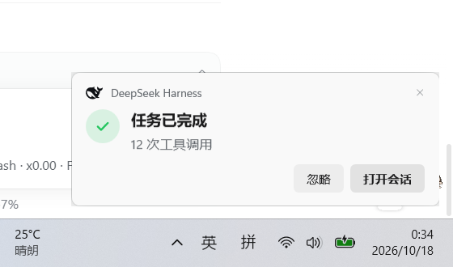

# DSH Task Notify · 任务通知

   

一个 [DeepSeek Harness](https://github.com/deepseek-ai/deepseek-harness) 插件：当任务**完成**、**失败**或**等待审批**时，在 Windows 右下角弹出系统级通知。

**DSH 窗口最小化、隐藏到托盘、甚至关掉 Web 页面，通知照常出现。**



---

## 为什么做这个插件

DeepSeek Harness 跑长任务时，你不可避免地会切到别的窗口干活。任务什么时候结束？失败了没有？是不是在等你批准某个操作？——切回来一眼看不出，干等又浪费时间。

这个插件把这三件事推到 Windows 通知的位置上，像收到一封邮件一样自然。

## 特性

- **三种状态，一眼区分**
  - ✅ **完成** — 绿色对勾，附会话标题、模型自己写的收尾总结、工具调用数
  - ⛔ **失败** — 红色感叹号，附失败原因（模型错误 / 超上下文 / 被中断）
  - ⏳ **待审批** — 琥珀色问号，附工具名和原因
- **独立进程渲染**：每次通知是一个独立的 `powershell.exe` + WPF 进程，不依赖 DSH 窗口的任何状态
- **官方鲸鱼标**：取自 DSH 自带的 `FishLogo` 矢量数据，浅色/深色主题自动切换描色
- **系统通知音**：完成/失败用 `Windows Notify.wav`，待审批用更轻的提示音，音量可调
- **堆叠管理**：多条通知纵向堆叠（最多 5 条），悬停暂停倒计时，点击或 Esc 关闭
- **内置调试面板**：设置 → 插件 → 任务通知，滑杆调时长/音量，一键静音，试弹三种状态
- **设置持久化**：面板改动写回 profile，重启保留
- **零外部依赖**：不需要装任何额外运行时，Windows 自带的 .NET Framework 4.8 就够

## 安装

### 前置要求

- DeepSeek Harness（桌面版或 `dsh` CLI）≥ 0.2.0
- Windows 10 / 11
- PowerShell 5.1（系统自带）

### 方式一：从 GitHub 直接安装（推荐）

插件包位于仓库的 `bundle/` 子目录，务必带上 `#path:/bundle`：

```powershell
& "$env:LOCALAPPDATA/Programs/DeepSeek Harness/resources/runtime/cli/bin/dsh.cmd" `
  plugin --profile desktop add github:AnsonLi-better/dsh-task-notify#path:/bundle
```

安装完成后**重启 DSH**（Host 半边即时生效，Client 面板需要页面刷新）。

> 自定义安装位置时，把 `dsh.cmd` 的路径换成你的实际路径。
> `--profile` 指定目标 profile，桌面端默认是 `desktop`。

### 方式二：在 Harness 里让助手安装

在 Harness 创造模式中说：

> 帮我安装任务通知插件：`github:AnsonLi-better/dsh-task-notify#path:/bundle`

### 方式三：本地目录（开发用）

```powershell
git clone https://github.com/AnsonLi-better/dsh-task-notify.git
& "$env:LOCALAPPDATA/Programs/DeepSeek Harness/resources/runtime/cli/bin/dsh.cmd" `
  plugin --profile desktop add "C:/path/to/dsh-task-notify/bundle"
```

也可以打开 DSH → 设置 → 插件 → 安装 bundle，选择仓库里的 `bundle/` 目录。

### 验证安装

```powershell
& "$env:LOCALAPPDATA/Programs/DeepSeek Harness/resources/runtime/cli/bin/dsh.cmd" `
  plugin --profile desktop why dsh-task-notify
```

### 手动验证

安装后，设置 → 插件 → **任务通知**，点「试弹一次 · 完成」，右下角应该出现绿色通知。同时 DSH 主窗口最小化再试一次，确认通知照常弹出。

### 卸载

```powershell
& "$env:LOCALAPPDATA/Programs/DeepSeek Harness/resources/runtime/cli/bin/dsh.cmd" `
  plugin --profile desktop remove dsh-task-notify
```

## 工作原理

```
┌─────────────────────────────────────────────────────────┐
│ DSH Host 进程（Node）                                    │
│                                                         │
│  session/event ──→ turn/end ──→ ┌─────────────────────┐ │
│  approval/request ────────────→ │  task-notify 插件    │ │
│                                 │  · 判断状态          │ │
│                                 │  · 组装标题/正文      │ │
│                                 └──────────┬──────────┘ │
└────────────────────────────────────────────┼────────────┘
                                             │ spawn
                                             ▼
┌─────────────────────────────────────────────────────────┐
│ powershell.exe（独立进程，一次一条通知）                    │
│  · WPF 无边框置顶窗（Topmost, ShowInTaskbar=false）       │
│  · 画卡片：鲸鱼标 + 状态图标 + 标题 + 正文 + 按钮          │
│  · 播放系统通知音（MediaPlayer，音量可控）                 │
│  · 自动关闭 / 点击关闭 / Esc                              │
└─────────────────────────────────────────────────────────┘
```

### 事件来源

| DSH 事件 | 判断 | 通知状态 |
|---|---|---|
| `session/event` → `turn/end` | `reason.kind === 'completed'` | 完成 |
| `session/event` → `turn/end` | `error` / `max-tokens` / `interrupted` | 失败 |
| `approval/request` | 任意工具审批 | 待审批 |

`forked` 和用户主动中止**不弹**，避免噪音。子代理默认不弹（面板里可开）。

### 内容怎么来

通知正文 = **会话标题 · 收尾总结 · 工具调用数**：

- **会话标题**：从 DSH 的 `sessionTitle` 服务读取，没有就省略
- **收尾总结**：取会话日志里最后一条 assistant 消息的最后一个文本块，去掉 Markdown 标记后取最后一个非空行——模型自己写的收尾就是最好的总结，不需要再调一次模型
- **工具调用数**：从会话日志统计 `tool/call` 事件

全部信息来自**已经落盘的会话日志**，插件不做任何模型请求，零额外成本。

## 配置

面板即改即生效，也支持在 profile 的 `cordis.patch.yml` 里预设：

```yaml
- id: task-notify
  name: 'dsh-task-notify'
  config:
    durationMs: 6000        # 停留时长（1500–60000）
    maxVisible: 3           # 同时最多几条（1–5）
    notifySubagents: false  # 子代理任务也弹
    sound: true             # 播放提示音
    soundVolume: 35         # 音量 0–100
    mute: false             # 全局静音
    theme: system           # system / light / dark
```

## 调试面板

设置 → 插件 → **任务通知**：

| 控件 | 说明 |
|---|---|
| 全部静音 | 一键停掉所有弹窗，不改动其他设置 |
| 停留时长 | 2–30 秒滑杆，鼠标悬停会暂停倒计时 |
| 提示音量 | 0–100，跟随系统音量 |
| 播放提示音 | 完成与失败用系统通知音，待审批用更轻的提示音 |
| 子任务也提醒 | 默认关闭，避免并行子任务刷屏 |
| 外观 | 跟随系统 / 浅色 / 深色 |
| 试弹一次 | 完成 / 失败 / 待审批，不用真跑任务 |

下方是运行状态（已弹出条数、正在显示条数、当前主题、平台）和最近 20 条事件流水（时间、状态、标题、耗时）。

## 已知限制

- **不进 Windows 通知中心**。系统 toast 只能由注册过 AppUserModelID 的应用进程发出，插件冒充不了 DSH 主程序，所以走自绘置顶窗口——历史通知无法在通知中心翻看。
- **仅 Windows**。macOS/Linux 需要各自的通知机制，未实现。
- **每次弹窗约 0.3–0.6 秒冷启动**。PowerShell 进程的固有开销，对"任务结束"这种秒级事件完全可接受。
- **审批通知不能直接批准**。点通知只是关闭弹窗，审批仍需回到 DSH 界面操作——这是安全边界，故意的。
- **「打开会话」需要页面处于加载状态**。跳转链路是 Host 通过 SSE 推送目标 session → 页面里的 Client 半边执行 `openSession`，所以 DSH 窗口必须已经打开（可以最小化）。页面恢复连接后会接收 Host 内尚未确认的跳转请求。

## 「打开会话」是怎么做到的

桌面版的 `dsh://open` 只负责唤起窗口。插件使用 SSE 推送目标会话：

1. 通知按钮向 Host 的本机接口发送一次性 token。
2. Host 通过 SSE 连接立即推送目标 sessionId。
3. Client 调用 DSH 的 `uiWorkspace.openSession(sessionId)`，成功调用后确认消费。
4. 通知进程在用户点击时通过 Windows 窗口 API 恢复现有 DSH 窗口并请求前台焦点；没有可激活窗口时才使用 `dsh://open` 启动兜底。启动兜底清除继承的 `ELECTRON_RUN_AS_NODE`。

这条连接不依赖设置面板是否打开，也不因页面隐藏而暂停。页面重新连接时，Host 会补发尚未确认的请求。Host 重启后不会保留待跳转请求。

回调地址使用 URL API 构造，保留认证查询参数。安装新版后需要重启 DSH，让 Host 和 Client 一起加载新代码。

已在 Windows 桌面版实际点击 WPF 通知验证：从另一个会话切回目标会话；窗口最小化时也能切回。验证同时检查桌面标题、侧边栏选中 sessionId 和 Host 请求确认状态。窗口激活另行验证 `IsIconic=false` 和 `GetForegroundWindow` 等于 DSH 窗口句柄；仅会话切换成功不代表窗口已唤起。 对已显示的主窗口只请求前台焦点，不重复调用显示命令；对最小化或隐藏的窗口使用 `ShowWindowAsync` 恢复，避免隐藏通知进程的启动显示状态影响主窗口。隐藏窗口通过枚举顶层窗口查找。正常、最小化、隐藏三种状态均测试通知关闭后持续 6 秒的窗口可见性。

## 目录结构

```
dsh-task-notify/
├── bundle/                    # DSH 插件本体（安装这个目录）
│   ├── package.json           # dsh.bundle + dsh.client 声明
│   ├── cordis.patch.yml       # Loader 行 + 默认配置
│   ├── index.js               # Host 半边：事件监听、进程管理、面板 API
│   ├── client.js              # Client 半边：设置面板
│   ├── assets/toast.ps1       # WPF 渲染脚本（UTF-8 with BOM，勿改编码）
│   ├── locale/{zh,en}.json    # 插件标题/描述
│   └── icon.svg               # 插件图标
├── design/preview/            # 截图
├── LICENSE
└── README.md
```

## 开发

```powershell
# 语法检查
node --check bundle/index.js
node --check bundle/client.js

# 单独测试渲染脚本（不经过 DSH）
$payload = @{ state='done'; theme='light'; title='任务已完成'; body='测试'; durationMs=4000 } | ConvertTo-Json
[System.IO.File]::WriteAllText("$env:TEMP\payload.json", $payload, [System.Text.UTF8Encoding]::new($false))
powershell -NoProfile -ExecutionPolicy Bypass -File bundle\assets\toast.ps1 -PayloadFile "$env:TEMP\payload.json"
```

改 `toast.ps1` 时注意三点（都踩过）：

1. 文件必须是 **UTF-8 with BOM**，否则 PowerShell 5.1 读中文会乱码报语法错
2. `Window` 不接受 `RenderTransform`，入场动画要加在内容 `Border` 上
3. `SystemParameters.WorkArea` 在 DPI 缩放下返回设备像素，而 `Window.Left/Top` 用 DIP，混用会跑出屏幕

## License

[MIT](LICENSE)
